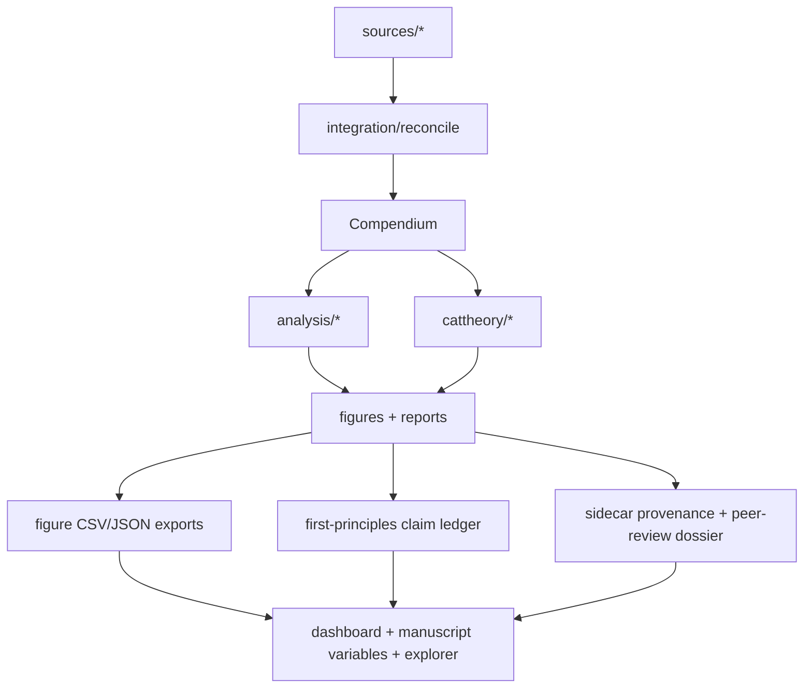

# The Music Never Stopped — Grateful Data Compendium

[](https://doi.org/10.5281/zenodo.20482025)
[](LICENSE)

> **📦 Published v1.0.0** — archived on Zenodo (DOI [10.5281/zenodo.20482025](https://doi.org/10.5281/zenodo.20482025))
> and released at [docxology/grateful_data](https://github.com/docxology/grateful_data/releases/tag/v1.0.0).
> Cite via [`CITATION.cff`](CITATION.cff).

A modular, citation-bound data compendium for the Grateful Dead universe: shows,
songs, performances, lyrics metadata, personnel timelines, recordings, venues,
and reception — paired with a category-theoretic interpretation of the
performance graph. The manuscript now has an explicit source dossier spanning
official archives, community taping history, MIR setlist segmentation, and
transformational/category-theoretic music scholarship, plus checked historical
context for formation, sound-system engineering, liveness, Deadhead sociology,
and public recognition. The statistical layer now reports distribution shape,
concentration, fixed-seed bootstrap intervals, and explicitly labelled
exploratory repertoire structure instead of leaving those facts implicit in
the figures. A first-principles claim ledger now binds major manuscript claims
to hard constraints, assumptions, validation artifacts, and interpretation
limits. Every registered panel also declares its data source, statistic,
exclusion rule, claim class, screen-reader alt text, and plotted CSV/JSON rows
under `output/data/figures/`. The publication pass now adds sidecar
provenance, pointer-only external audio/lyric manifests, a static explorer
with related figure/provenance links, a peer-review dossier, and a strict
publication-output validator without changing the frozen entity schema or
promoting the project out of `working/`.

**Status:** Dual-tier compendium: **`data/seed/`** (83-show CI demonstrator,
pinned tests) and **`data/archival/`** (committed gdshowsdb snapshot, **3,341
ingested shows**; community literature estimates ~2,318 canonical concerts for
the full corpus). Ten **reference parsers** in `src/sources/` plus **`src/ingest/`**
online fetch/normalize paths (gdshowsdb + truckin-through-time gap-fill at
archival scale). Tests default to the seed tier — deterministic, network-free,
no mocks.

## Quick Start

```bash
git clone https://github.com/docxology/grateful_data.git
cd grateful_data
uv sync --extra dev

```bash
# Seed tier (CI default)
uv run python scripts/99_pipeline.py --tier seed
uv run --extra dev pytest tests/ --cov=src --cov-fail-under=90

# Archival tier (full gdshowsdb snapshot — requires data/archival/)
uv run python scripts/00_fetch_sources.py --online --write-archival
GRATEFUL_DATA_TIER=archival uv run python scripts/99_pipeline.py --tier archival

# Publication gate after rendering
uv run python scripts/20_validate_publication_outputs.py --strict
uv run python scripts/21_release_prep.py --dry-run
```

Manuscript-hydration tests need the template checkout that provides
`infrastructure/rendering/`; they skip when it is not discoverable from the
repository's parent directories — set `TEMPLATE_REPO_ROOT` to point at it.

## What's bundled vs scalable

| Tier | Path | Shows | Role |
| --- | --- | ---: | --- |
| Seed (CI) | `data/seed/` | 83 | Pinned tests, fast pipeline |
| Archival | `data/archival/` | 3,341 | gdshowsdb + truckin gap-fill + curated layers; 16.6k segue markers |

Refresh archival: `uv run python scripts/00_fetch_sources.py --online --write-archival`
(see [`data/archival/README.md`](data/archival/README.md)).
For a non-destructive refresh comparison, use
`uv run python scripts/22_archival_refresh_diff.py --candidate-dir <archival-shaped-dir>`;
online refresh candidates are written only under `output/refresh/`.

| Layer | Seed | Archival (typical) | Scales by |
| --- | ---: | ---: | --- |
| Shows | 83 | 3,341 | gdshowsdb YAML + truckin SQLite + optional Setlist.fm |
| Songs | 88 | 645 | gdshowsdb + truckin + `sources/alex_allan` / whitegum |
| Performances | 341 | 40,757 | `performances.json` at archival tier (segue markers preserved) |
| Personnel | 14 | 14 (curated) | `sources/dead_net` + Wikipedia |
| Venues | 25 | 912 | derived from show ingestion |
| Recordings | 6 | 7,122 | Internet Archive LMA (`--archival-max`) |
| Reviews | 12 | 1,888 | maximinus corpus + curated exemplar |
| Citations | 26 | 139 | bibliography MD + `docs/manuscript/references.bib` |
| Lyric pointers | 25 | 548 | CMU index + curated overlay + dead.net URLs (no lyric text) |
| Full lyric text | **NOT bundled** | **NOT bundled** | pointers only |

The compendium is honest about what it contains. The bundled seed is sufficient
for the manuscript's quantitative claims and category-theoretic constructions.
Full-corpus ingestion is the scaling path, not the present claim.

## Architecture



See [AGENTS.md](AGENTS.md) for module-by-module documentation.
See [TODO.md](TODO.md) for the minor/medium/large improvement roadmap.

## Publication Artifacts

| Artifact | Path | Purpose |
| --- | --- | --- |
| Dashboard | `output/dashboard.html` | Sectioned static figure browser with raw CSV/JSON links |
| Figure data | `output/data/figures/` | Registry-backed plotted data exports and index |
| Provenance sidecar | `output/data/provenance/` | Entity/source-layer provenance without schema mutation |
| External manifests | `output/data/external/` | Pointer-only audio/lyric manifests plus future-pipeline contract; no protected content |
| Static explorer | `output/explorer/index.html` | Plain HTML/JS filters for shows, songs, venues, segues, figures, claims, provenance |
| Peer-review dossier | `output/reports/peer_review_dossier.{json,md}` | Claim-to-artifact map for reviewers |
| Publication validation | `output/reports/publication_validation.json` | PDF/HTML/dashboard/figure-data/citation/token checks |
| Release prep | `output/reports/release_prep.json` | Command-order and execution report for release gate |

The explorer is intentionally framework-free. It supports URL-state filters,
sortable table headers, related links, and filtered CSV downloads so reviewers
can inspect show, song, venue, segue, figure, claim, and provenance subsets
locally.

Useful inspection commands:

```bash
GRATEFUL_DATA_TIER=archival uv run python -m src.cli provenance songs scarlet_begonias
python -m json.tool output/reports/analysis_report.json | rg "transition_sensitivity|repertoire_topn_sensitivity|venue_identity_review"
python -m json.tool output/reports/publication_validation.json
python -m json.tool output/data/figures/index.json
```

## Citations and Scholarship

`docs/manuscript/references.bib` carries both source-parser references and the
scholarly frame for the paper: UCSC and Internet Archive archival context,
dead.net and Wallace on taping/community curation, Dodd/Trist on lyric
annotation, MIR setlist segmentation, Brackett and Marshall on liveness and
tape-trading, Adams/Sardiello and Dodd/Weiner on Deadhead scholarship and
bibliographic scope, official Rock Hall/Recording Academy/Kennedy Center
recognition sources, and Lewin/NIST/Popoff-Andreatta for the music-theory and
category-theory framing. The integration layer is designed so each source
parser is independently testable on its bundled fixture and independently
swappable for an online fetcher.
